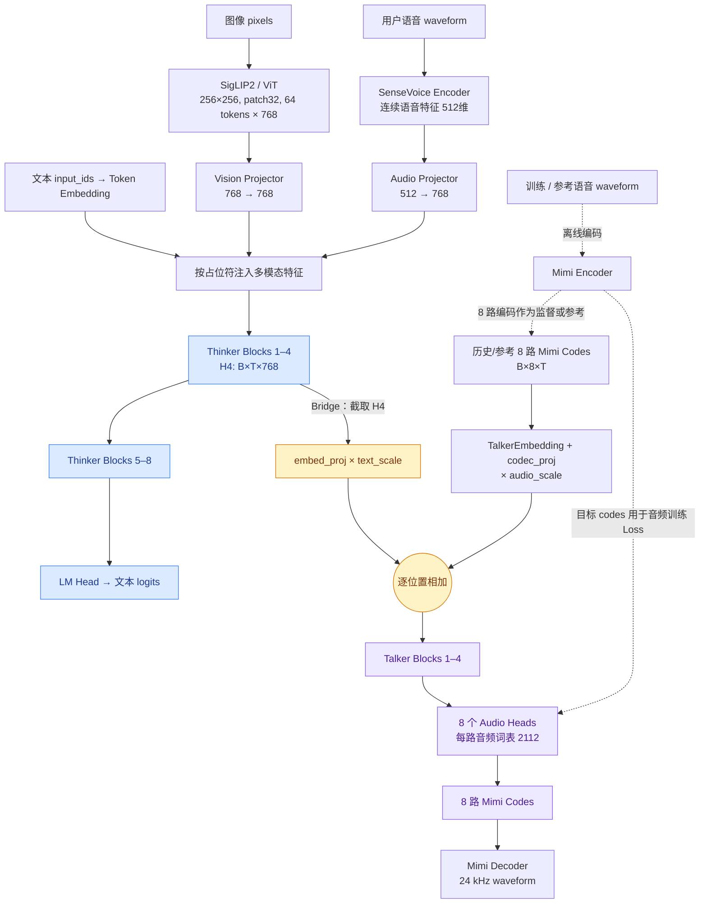
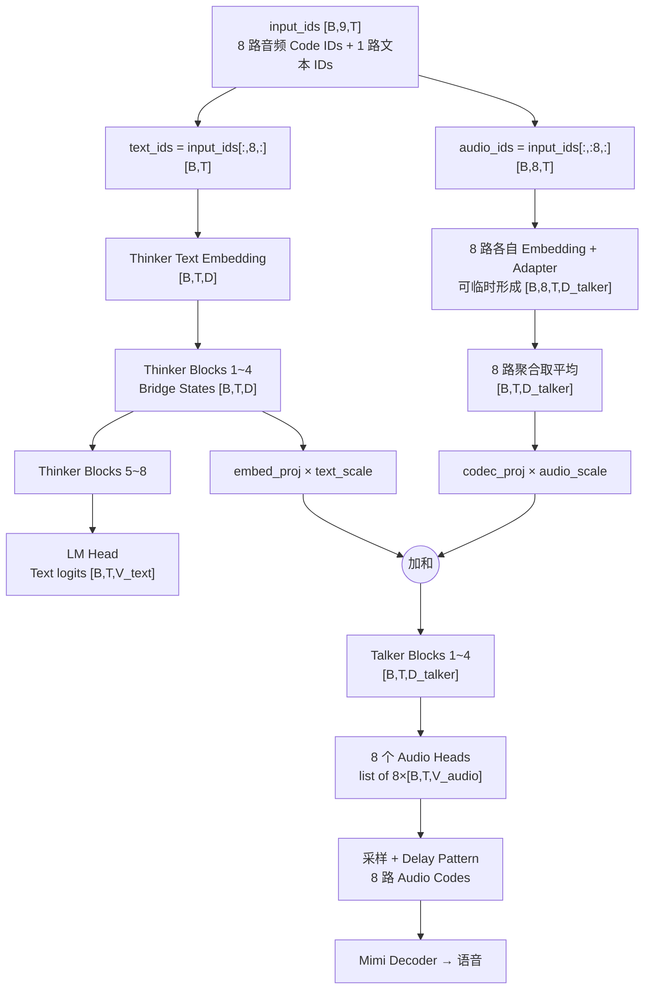
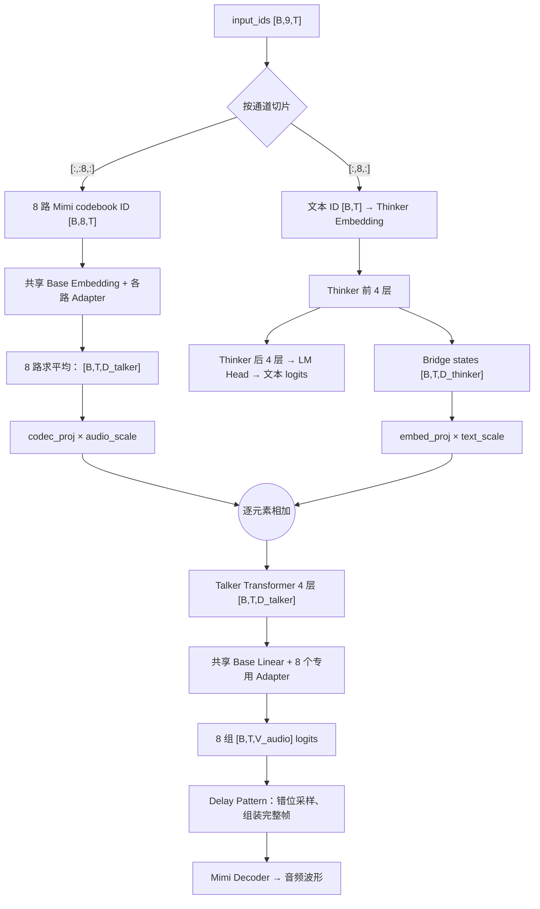

# Omni++ 学习 Q&A：Mimi / Thinker–Bridge–Talker / ViT / 多模态占位符

> 日期：2026-11-03  
> 学习对象：上传的 `model_omni(2).py`、相关 `model_minimind(2).py`，以及 MiniMind-O 官方 `dataset/omni_dataset.py`、`eval_omni.py`。  
> 核心目标：理解哪些模块处理输入、Thinker 与 Talker 如何交接，以及输入序列的真实排列方式。

## 一、原始问题

1. **mimi-encoder是什么？在架构的哪里？**
2. **我还是没理解bridge layer在干什么，给我一个清晰的架构图例子，包括thinker-bridge-talker三者的关系图（可以用具体数字做例子，但是给出各个数字的选择原因）。这一块好好讲一下。**
3. **vision encoder应该是里面还有ViT是吗？所以原始pixels经过vision encoder直接就是先卷积，再ViT（双向注意力）是吗？**
4. **在这个omni架构中，视觉占位符和音频占位符都在哪里？有多少个？排列顺序如何？**

---

## 二、全景架构图

### 2.1 可直接在 GitHub / Markdown Mermaid 环境中渲染的结构图



**阅读顺序：** 输入编码器只负责把不同模态变成特征；Thinker 的第 4 层输出向下分叉；一条继续 Thinker 的第 5–8 层输出文本，另一条作为 Talker 的语义条件生成 8 路声学 Codes。Mimi Encoder/Decoder 是外部 Codec，不是 Thinker–Talker 之间的 Bridge。

另提供清晰的矢量 SVG 与 PNG（与本笔记同目录）：`Omni++_Thinker_Bridge_Talker_架构图.svg` / `.png`。

### 2.2 Thinker–Bridge–Talker 的张量尺寸实例

假设 **B=1、T=72、D=768**。其中 T=72 **只是教学例子**：人为取 8 个文本位置 + 64 个图像位置；真实长度取决于 Tokenizer 和 Chat Template，不应将 8 视为实际分词结果。

| 步骤 | 张量形状 | 数值来源 / 选择理由 |
|---|---|---|
| 文本 + 图像融合嵌入 `H0` | `[1, 72, 768]` | B=1 示例；T=8+64 示例；768 来自 `config.hidden_size` |
| Thinker Block 1～4 | `[1,72,768]` | `num_hidden_layers=8`；Bridge 取中间层 |
| **Bridge `H4`** | **`[1,72,768]`** | `bridge_layer=8//2-1=3`，Python 索引 3 是第 4 个 Block 的输出 |
| Thinker Block 5～8 | `[1,72,768]` | Backbone 后半段继续输出文本信息；Bridge 不会切断主干 |
| Thinker LM Head | `[1,72,V_text]` | `V_text=config.vocab_size`，默认 6400 |
| 历史音频代码 `audio_ids` | `[1,8,72]` | 8 路 Mimi codebook；音频少于 T 的位置使用 pad / 参考音频上下文 |
| `talker.embed_tokens` + `codec_proj` | `[1,72,768]` | 将 8 路代码转换为 Talker 的统一隐藏向量 |
| `talker.embed_proj(Bridge)` | `[1,72,768]` | Thinker hidden 768 → Talker hidden 768；两者默认值恰好相同，仍执行非线性投影 |
| 两路投影相加 | `[1,72,768]` | `text_scale` 初始 3.0、`audio_scale` 初始 1.0；两者都是可训练参数 |
| Talker Block 1～4 | `[1,72,768]` | `num_talker_hidden_layers=4` |
| TalkerHead 输出 | 8 个 `[1,72,2112]` | 8 路 Codebook；每路含 2048 声学 Code ID + 64 个特殊 ID 预留空间 |
| Mimi Decoder | waveform | 将正确对齐的音频 Codes 还原成 24 kHz 声音 |

**Bridge 核心原理：** 这里的 `bridge_layer` 不是额外的一层，也不是把文本生成结果送到 TTS；它是一个**中间隐藏状态的读取位置**。第 4 层输出被赋给 `bridge_states`（保留张量引用，不执行 `clone()`），原来的 Thinker 仍继续计算第 5～8 层：

```python
# model_omni.py, 核心逻辑
for i, (layer, past_key_value) in enumerate(...):
    hidden_states, present = layer(...)
    if i == self.config.bridge_layer:
        bridge_states = hidden_states

# Talker 由中间特征 + 历史音频 codes 共同条件化
hidden_states = (
    self.talker.embed_proj(bridge_states) * self.talker.text_scale
    + self.talker.codec_proj(talker_emb) * self.talker.audio_scale
)
```

公式：

\[
H_{talker}^{(0)}=\alpha\,P_t(H_{thinker}^{(4)})+\beta\,P_a(E_{audio}(C))
\]

**为什么取中间层？** Embedding 尚未融合丰富上下文；最后一层更贴近文本 logits；中间层可能更适合作为声学生成条件。但“第 4 层最好”只是合理的默认设计，并非必然事实，可对 `bridge_layer=1/3/5/7` 做消融。

**反向传播：** `bridge_states` 没有 `detach()`，所以联合训练时 Talker Loss 可以通过 `embed_proj` 影响 Thinker 前四层（若这些层未被冻结）。

---

## 三、Q1：Mimi Encoder 是什么，在什么位置？

- **Mimi Encoder**：`waveform → 压缩/量化 → 8 路离散 audio codebooks`，主要用于**离线生成训练目标**与**参考语音条件 ref_codes**。
- **Mimi Decoder**：`8 路 codes → waveform`，主要用于推理阶段从 Talker 的输出复原音频。
- **SenseVoice Encoder**：`用户语音 → 连续语音特征 → AudioProjector → Thinker`，它与 Mimi **不是同一个编码器**，也没有经过 Mimi 才能输入 Thinker。
- `model_omni.py` 没有定义或实例化 Mimi；实际 `eval_omni.py` 将 `MimiModel` 装到 `model.mimi_model`，使用 `.decode()` 输出 WAV。训练数据保存了预提取的 Mimi codes。
- **代码地址**：`model_omni.py:123–181`（SenseVoice）、`:295–316`（Talker 输出）、`eval_omni.py:9, 37, 63–76`（Mimi 解码）。

---

## 四、Q3：Vision Encoder 的 ViT 是怎样工作的？

以 `SigLIP2 base-p32-256` 为例：

```text
pixels: [B,3,256,256]
    → Patch Embedding（通常是 Conv2d，kernel=stride=32）
    → 8×8=64 个 Patch Tokens，维度 768
    → ViT Blocks（非因果/双向 Self-Attention + FFN）
    → last_hidden_state: [B,64,768]
    → MMVisionProjector: [B,64,768]
    → 注入 Thinker 的图像占位符区间
```

- 卷积在这里主要用来**切 Patch + 线性投影**，不是普通 CNN 的多层图像语义提取。
- ViT 的 Self-Attention 默认**双向**，一个 Patch 可以访问全部其他 Patch；Thinker 的解码器注意力**因果**，每个位置只能访问当前和以前的位置。
- `MMVisionProjector` 是 LayerNorm→Linear→GELU→Linear，**只改变特征，不改变 token 数**；代码虽然有 `source_tokens` / `target_tokens` 参数，但没有真实重采样实现。
- 64 的来源是 `(256/32)^2`；768 是选定模型 hidden size，不是图像尺寸计算所得。
- **代码地址**：`model_omni.py:44–54`（Projector）、`:183–243`（视觉编码及注入）。

---

## 五、Q4：多模态占位符在哪里、各有多少个、顺序怎样？

### 5.1 最重要：区分 **文本主序列的占位符** 与 **Talker 的 8 路 audio codes**

`model_omni.py:245–252` 对两种输入格式兼容：

```python
# 仅文本形式，推理时常见
input_ids: [B, T]
# 模型自动创建 audio_ids: [B,8,T]，填 audio_pad_token=2049

# 训练 / 已组织音频 codes 的联合格式
input_ids: [B,9,T]
text_ids  = input_ids[:,8,:]    # 第 9 路：文本 token、图像/音频占位符
audio_ids = input_ids[:,:8,:]  # 前 8 路：历史/参考音频 codes
```

**在 `text_ids` 一条序列内部：**

| 占位符 | 默认 Token ID | 数量 | 实际代表的内容 | 在哪里 |
|---|---:|---:|---|---|
| `<\|image_pad\|>` | `12` | **每图 64 个**（默认） | SigLIP2 生成的 64 个视觉特征位置 | `text_ids` / Thinker 的 Embedding 序列 |
| `<\|audio_pad\|>` | `16` | **动态的 L 个** | SenseVoice 输入语音特征位置；L 依据音频预处理 `valid_len` | 同一条 `text_ids` / Thinker 的 Embedding 序列 |
| `audio_pad_token` | `2049` | 取决于音频序列中的空白位置 | Talker 的 codec 侧填充值，不是文本 Token ID `16` | 独立的 8 路 `audio_ids` |
| `audio_spk_token` | `2051` | 音色条件位置可出现 | Talker 说话人条件位置 | 独立的 8 路 `audio_ids` |

注意“音频有 8 路”**不等于**“输入语音放 8 个 `<|audio_pad|>`”。前者是 **Mimi Codec codebooks**，后者是 **SenseVoice 语音特征的占位长度**。

### 5.2 示例顺序：不是固定「先图像再音频」

**图像问答的推理样例（`eval_omni.py`）**：

```text
[text: 请描述这张图片] [image_pad × 64]
```

**语音问答的推理样例**：

```text
[audio_pad × L]
```

**训练数据（`OmniDataset.create_chat_prompt()`）**：最后一轮用户的语音占位符可能单独出现、放在文本前、文本后，或者只保留文本；含 `<image>` 的内容也可能将图像标记放到文本前后。图文/语音混合没有被这段代码限定为全局固定顺序。

```text
例 A：[文本] → [图像 64 位] → [文本]
例 B：[音频 L 位] → [文本]
例 C：[文本] → [音频 L 位]
例 D：[图像 64 位] → [文本] → [音频 L 位]  （逻辑示意）
```

### 5.3 模型怎样把特征填进去？

```text
Tokenizer → 占位符的普通 Embedding
视觉特征 V=[B,64,768]  → 替换连续的 image_pad 区间
语音特征 A=[B,L,768]   → 替换连续的 audio_pad 区间
最后进入 Thinker 的还是 [B,T,768]
```

- **音频**：`inject_audio_features()` 查找连续 `audio_ids[0]` 标记，按长度用投影后的特征替换。
- **视觉**：`count_vision_proj()` 查找连续 `image_ids[0]` 标记，用对应视觉特征拼接替换。在**占位数=特征数=64** 时是等长替换；不等长时该实现会拼接、截断，未实现通用动态对齐。
- **数据集核对**：`OmniDataset.__init__` 设置 `self.image_token='<|image_pad|>' * 64`，音频 `self.audio_token * audio_features_length`；`__getitem__` 将 `<image>` 换成连续 image token。

---

## 六、组件概览表（简要总结）

| 组件 | 主要职责 | 典型输入→输出 | 是否是 MiniMind-O 可训练主干 |
|---|---|---|---|
| Text Tokenizer / Embedding | 文本转 ID 和隐藏特征 | `IDs → [B,T,768]` | Embedding 是；Tokenizer 不是 |
| Vision Encoder（SigLIP2 ViT） | 将图片编码为 Patch 特征 | `[B,3,256,256] → [B,64,768]` | 否，冻结 |
| Vision Projector | 对齐到 LLM 隐空间 | `768→768` | 是 |
| Audio Encoder（SenseVoice） | 理解用户语音，提取连续特征 | 16 kHz 输入语音 → 512 维特征 | 否，冻结 |
| Audio Projector | 对齐音频特征维度 | `512→768` | 是 |
| Thinker | 多模态融合 + 文本预测 | `[B,T,768] → 文本 logits` | 是，8 个 Block |
| Bridge States | 读取 Thinker 中间层作为语音条件 | `H4: [B,T,768]` | **不是独立网络层**；后续 `embed_proj` 可训练 |
| TalkerEmbedding / codec_proj | 历史 8 路 Codes → 声学隐藏特征 | `[B,8,T] → [B,T,768]` | 是 |
| Talker | 条件化预测音频的 Transformer | `[B,T,768] → [B,T,768]` | 是，4 个 Block |
| TalkerHead × 8 | 分别预测 8 层 Codebook 的 logits | 每路 `[B,T,2112]` | 是 |
| Mimi Encoder | 语音波形转 8 路 Codes | waveform → `[8,T_audio]` | 否，冻结/离线使用 |
| Mimi Decoder | 将 8 路 Codes 复原为语音 | `[8,T_audio] → waveform` | 否，冻结 |
| CAM++ / Speaker Condition | 音色条件 | `spk_emb: 192 → Talker 768` | 外部说话人特征预提取；`spk_proj` 可训练 |
| VAD / RealtimeSession | 判断语音开始结束、处理中断 | 音频块 → 事件 | 否，工程模块 |

**特别提醒：** 以上尺寸来自这份 MiniMind-O 的默认配置；更换 encoder、Tokenizer、Talker 维度时需要同步改配置、投影层和权重映射。Mimi 8 路 Codebook 不代表 8 个独立声道。

---

## 七、关键易错点（面试复习）

1. **Bridge 不是中间多加了一个 Transformer 层**：`bridge_layer=3` 表示 Python 索引 3 的 Block 输出，即第 4 层。
2. **Thinker 并非先全部生成完文本才调用 Talker**：它通过中间隐藏状态条件化 Talker；生成时两种代码流通过错位调度对齐。
3. **Mimi Encoder 不负责用户语音理解**：这条路径属于 SenseVoice；Mimi 是 Codec。
4. **不是所有图像都天然可读**：Vision Projector 到 LLM 的语义对齐仍需训练。
5. **Thinker 图像/音频占位符与 Talker 8 路 code streams 是不同概念**：前者位于文本序列；后者是单独的音频代码输入。
6. **图像标记 12、音频标记 16、Codec Pad 2049 属于不同词表/通道**，不能混淆。
7. **图像 64 个占位符是当前配置约定**，不是多模态模型普遍不变的规则；语音占位符数量是动态的。
8. **中间层更适合 Talker 只是设计假设**：应通过 `bridge_layer` 消融研究。

## 参考源码

- 用户上传：`model_omni(2).py`、`model_minimind(2).py`。
- MiniMind-O 源码：https://github.com/jingyaogong/minimind-o/blob/master/model/model_omni.py
- 数据格式：https://raw.githubusercontent.com/jingyaogong/minimind-o/master/dataset/omni_dataset.py
- 推理链路：https://raw.githubusercontent.com/jingyaogong/minimind-o/master/eval_omni.py
- README / 模块配置：https://github.com/jingyaogong/minimind-o/blob/master/README_en.md

---

## 八、续问：Thinker–Talker 是否独立训练？8 路 Codes 的完整数据流

### 8.1 原始问题（2026-11-03）

1. **所以说相比于传统的串联式tts，thinker-talker其实是分别训练文本和音频是吗**
2. **8路audio codes的架构是什么意思？形状是什么？既然9是channels，T是token数，也就是说audio的token数其实和text一眼，然后最后都会变成（B，9，T，d）是吗，也就是说我们用8个通道分别学习text对应的audio的特征，最后一维度文本就是直接放到lm中；或者是这个inputs统一放到lm，然后最后第二个维度的最后一行的文本部分拿出来进入lm head，8个通道audio放到bridgestate中是吗，但这样的话bridge是在中间层就开始训练了，后一半层的thinker还有8路音频的事情吗**
3. **inputs这样的形状相比lm中的（B，T）其实是为了统一组合起来audio和text以及二者的对应关系，我的理解如何？**

### 8.2 一句话抓住核心

- Thinker 与 Talker **分支不同、任务不同，但有可微 Bridge，可以联合训练**；仅依据 `model_omni.py` 无法判断真实训练脚本的训练阶段与损失权重。
- `[B,9,T]` 是 **8 路 audio-code IDs + 1 路 text IDs 的打包格式**，不是喂给一个 Transformer 的 9 维联合特征。
- Thinker 只读 `text_ids=[B,T]`；Talker 使用 **8 路 codes 融合后的 `[B,T,D_talker]`**，以及 Thinker 第 4 层的 Bridge hidden states。
- 输出有 **1 组 text logits** 和 **8 组 audio logits**；前者 `[B,T,V_text]`，后者是长度 8 的列表、每项 `[B,T,V_audio]`。

### 8.3 源码数据流 Mermaid



**具体源码**：`MiniMindOmni.forward()` 对 `input_ids` 切片后，分别调用 `thinker.embed_tokens(text_ids)` 与 `talker.embed_tokens(audio_ids)`；两分支在 `talker.embed_proj(bridge_states) * text_scale + talker.codec_proj(talker_emb) * audio_scale` 处汇合。不能说“8 路音频输入放入 Bridge”：Bridge 是 **Thinker 的中间输出**。

### 8.4 张量维度实算

假设 `B=2`，`T=100`，Thinker/Talker hidden size 均为 `768`，`V_text=6400`，`V_audio=2112`（后面三者沿用默认配置）。

| 对象 | 形状 | 解释 |
|---|---|---|
| `input_ids` | `[2,9,100]` | 9 条离散 ID 流、共享打包时间轴 |
| `text_ids` | `[2,100]` | 仅通道 8（第 9 条） |
| `audio_ids` | `[2,8,100]` | 通道 0～7 |
| `thinker.embed_tokens(text_ids)` | `[2,100,768]` | **只有 1 条文本隐藏序列**，可能已注入视觉/语音特征 |
| 4th Thinker Block / `bridge_states` | `[2,100,768]` | Thinker 的中间隐藏状态 |
| 8th Thinker Block | `[2,100,768]` | 后半段继续用于文本生成 |
| `thinker.lm_head` | `[2,100,6400]` | 文本词表 logits |
| `talker.embed_tokens(audio_ids)` | `[2,100,768]` | **8 路融合后只有 1 条**，不是 `[2,8,100,768]` 最终形式 |
| `talker.embed_proj(bridge_states)` | `[2,100,768]` | 语义条件的投影 |
| 两个投影加和后的 Talker 输入 | `[2,100,768]` | 融合后的声学条件序列 |
| Talker 4 层后 | `[2,100,768]` | 声学生成隐藏状态 |
| `talker.lm_head` | `list` 长度 8，每项 `[2,100,2112]` | 各 Codebook 的分类 logits |

**TalkerEmbedding 公式**：设输入的第 `i` 路 Code IDs 为 `c_i [B,T]`，则

\[
e_i = \mathrm{Embedding}_{\mathrm{shared}}(c_i)+\mathrm{Adapter}_i(c_i),\qquad
E_{audio}=\frac{1}{8}\sum_{i=0}^{7}e_i\in\mathbb R^{B\times T\times D_{talker}}.
\]

代码的 `base_out` 中间确实可表示为 `[B,8,T,D]`，但它紧接着**沿 8 路合并**，然后 `codec_proj` 才交给 Talker。`TalkerHead` 则使用一个共享 `base` 加 8 个不同 `adapter`，产生 8 组 logits。

### 8.5 Thinker 后四层是否还与音频相关？

- **前向计算上**：第 5～8 层不直接生成 `audio_logits`，它们把 `H4` 进一步处理为文本预测；Talker 直接读取 `H4`，**不读取 H8**。
- **反向传播上**：在联合训练且权重可训练的情况下，`L_audio → Talker → embed_proj → H4 → Thinker 前 4 层`；不直接经过 Thinker 的第 5～8 层。`L_text → LM Head → Thinker 第 8～1 层`。
- **自回归生成上**：后四层确定当前文本 token；这个 token 在下一轮成为 Thinker 输入，通过新一轮的 H4 **间接影响后续** Audio Codes。

联合优化常见形式（**示意，并非从本文件验证的训练脚本配置**）：

\[
L_{total}=L_{text}+\lambda_{audio}L_{audio}+L_{aux}.
\]

需要检查 `train_sft_omni.py` 等外部脚本，才能确认是否采取预训练→分阶段冻结→联合训练、Loss 具体加权等。`model_omni.py` 的 `forward()` 本身**没有计算交叉熵**，只返回文本、音频 logits 与辅助项。

### 8.6 “共同 T 轴”不等于音频帧与文本 token 1:1

`[B,9,T]` 让 8 路 Audio Codes 和 1 路 Text Tokens 按**模型生成步骤**装入同宽数组，配合 Pad/特殊符号和 **Delay Pattern**，但真实文字 token 数与 Codec 音频帧数没有天然相等关系。

这份 `stream_generate()` 中 `audio_step = step - 1`，并在 `audio_step < i` 时让第 `i` 路先输出 pad。因此（非 `open_thinking` 分支）：

| 模型生成 `step` | 文本预测 | Codebook 0 | Codebook 1 | … | Codebook 7 |
|---:|---|---|---|---|---|
| 0 | ✔ | pad | pad | … | pad |
| 1 | ✔ | ✔ | pad | … | pad |
| 2 | ✔ | ✔ | ✔ | … | pad |
| 8 | ✔ | ✔ | ✔ | … | ✔ |

音频还可能在文本 EOS 后继续生成，因此**不能**推断 `T_audio_frames=T_text_tokens`。同一时间步也不必对应同一段语义/相同时间戳。

### 8.7 易错点

1. `[B,9,T]` 的“9”表示独立的离散码流，不是 9 个 Attention heads、也不是 9 个已经编码的 d 维特征通道。
2. 8 路 Audio Codes 不是分别送进 Thinker；是由 `TalkerEmbedding` 融合后送到 Talker。
3. `bridge_states` 来自 Thinker 中间层，**不是 8 路音频结果**。
4. Bridge 的音频损失只沿中间层及其之前的模块直接回传，后四层主要通过文本损失学习。
5. `[B,8,T]` 中的 T 只是联合打包长度，不代表与文本的有效 token 数严格相等。
6. `TalkerHead` 的 8 路输出是 8 份分类 logits，不是直接生成连续波形；还需采样、拼帧、Mimi 解码。

**代码依据**：上传的 `model_omni(2).py`，尤其 `TalkerEmbedding.forward`（68–76）、`TalkerHead`（57–65）、`MiniMindOmni.forward`（245–316）、`stream_generate`（326–395）。

---

## 九、续问：8 路 Codebook 融合、Bridge 投影、TalkerHead 与 Delay Pattern（2026-11-03）

### 9.1 原始问题

1. **audio_ids到talkerembedding，为什么消除了通道数？为什么不用（2，8，100，768）然后对于每个通道用bridge的输出进行广播？这样的话不就没有通道的信息了吗？那还分出来8个通道干什么？所以一个通道到底是什么？**
2. **bridge和talkerembedding的融合那里，特征投影是怎么做的？加权相加又是怎么做的？**
3. **最后的talkerhead到底是什么意思？一个head对应着什么？**
4. **\[e_i=E_{\text{base},i}+Adapter_i(c_i)\]这里的adapter是什么？这个公式在干什么？**
5. **继续讲解什么是Padding + Delay Pattern（延迟模式）和图片中的知识。**

### 9.2 结构总览（源码对应 `TalkerEmbedding`、`TalkerModule`、`TalkerHead`）



### 9.3 问题 1：为什么 8 路进、1 路隐藏、8 路出？

`[B,8,T]` 的“8”不是声道，也不是 8 份不同的语音，而是**同一音频帧在 8 个离散码本中的编号**。例如一个声学帧 `c_t=[12,35,87,21,66,43,19,52]`，8 个 ID 协同表示该帧。它们以相同的生成步骤轴 T 打包，但文本 token 与真实声学帧并不天然一一对应。

输入 `audio_ids [B,8,T]` 经过共享 Base Embedding，暂时得到 `[B,8,T,D]`，但 `TalkerEmbedding.forward()` 对各路进行专用 Adapter 补偿后**按 Codebook 维取平均**，得到 `[B,T,D]`。这让一个共享 Talker Transformer 就能加工聚合的历史声学条件，避免简单地在 8 路上重复 8 次完整 Transformer。

“信息是否丢失”：压缩求和**没有可逆性保证**，确实可能丢失信息；但不同的 `Adapter_i` 带有 Codebook 身份，让相同 ID 位于不同码本时通常产生不同特征。模型目标是提取足够的未来声学预测条件，而非逐位精确还原 8 个输入 ID。保留 `[B,8,T,D]` 再用 Bridge 广播在设计上可行，但需要定义 8 路如何交互/共享层，不是这份 MiniMind-O 的架构。

### 9.4 问题 2：Bridge 与 Audio 特征投影融合

用源码默认数字：`D_thinker = D_talker = 768`、`B=2`、`T=100`。

- Bridge: `[2,100,768] → embed_proj: Linear(768,768) → GELU → Linear(768,768) → RMSNorm → [2,100,768]`。
- Audio: `[2,8,100] → TalkerEmbedding → [2,100,768] → codec_proj: Linear(768,768) → GELU → Linear(768,768) → RMSNorm → [2,100,768]`。
- 融合：`h_talker = text_scale * embed_proj(bridge_states) + audio_scale * codec_proj(talker_emb)`，两条张量同形状，逐元素相加，不进行 concat、Attention 或 Codebook 维广播。
- `text_scale` 初始为 3.0；`audio_scale` 初始为 1.0，**二者都是可训练的标量参数**，初始比例不意味着训练后始终 3:1。

例子：投影后某位置 3 个维度 `h_text=[0.2,0.5,0.1]`，`h_audio=[0.4,0.1,0.3]`，初始融合为 `3*h_text + h_audio=[1.0,1.6,0.6]`。

### 9.5 问题 3–4：TalkerEmbedding、TalkerHead 及 Adapter

**TalkerEmbedding：** `self.base=Embedding(V_audio,D)`；每个 `Adapter_i` 的路径是 `Embedding(V_audio, rank=256) → GELU → Linear(256,D)`。对第 i 路 Code IDs `c_i [B,T]`：

\[
 e_i=E_{\mathrm{base}}(c_i)+A_i(c_i),\qquad
 e_{\mathrm{audio}}=\frac18\sum_{i=0}^{7}e_i\in\mathbb R^{B\times T\times D}.
\]

- 共享 `E_base` 学习通用的离散编码表示；不同的 `A_i` 学习 Codebook 专属修正。此处 Adapter 是**低维瓶颈分支**，不等同于“冻结模型后做 LoRA 微调”；是否冻结没有由这个类决定。
- `rank=256` 是瓶颈中间维度；`D=768` 是最终嵌入维度；每个 e_i 都是 `[B,T,768]`。

**TalkerHead：** 输入融合后 Talker 输出 `h [B,T,768]`。先共享 `base=Linear(768,2112)`，再由 8 个独立 `Adapter_i` (`Linear(768,256) → GELU → Linear(256,2112)`) 生成 8 组预测：

\[
 logits_i=W_{\mathrm{base}}h+A_i^{\mathrm{out}}(h)\in\mathbb R^{B\times T\times 2112},\quad i=0,\ldots,7.
\]

8 个 **Audio Heads 分别预测 8 个 Codebook 的候选 ID**（每路 2112 个 logits）；这不是 8 个 Attention Heads，也不是对 8 个输入向量分别跑一次 Talker。**共享的 Talker 隐藏序列 → 8 个不同输出分布**。

### 9.6 问题 5：Padding + Delay Pattern 的动机和源码步进

**为什么要延迟？** 一个最终能交给 Mimi Decoder 的声学帧，必须收齐 8 路 Codebook ID。把 8 路生成任务错开后，模型可在统一的自回归生成步骤轴上逐步补齐；同一步可能为**不同声学帧**生成来自不同 Codebook 的 ID。

源码（`stream_generate()`，普通模式、`open_thinking=False`）：

```python
step = input_ids.shape[1] - start_pos
audio_step = step - 1
for i, al in enumerate(out.audio_logits):
    if audio_step < i:
        audio_codes[i].append(self.audio_pad_token)  # 默认 2049
    else:
        # 从第 i 个 Audio Head 的 logits 中采样 Code ID
        audio_codes[i].append(code)
```

要激活第 i 个 Head，条件是 `step >= i + 1`：**step 0 全部 pad，step 1 开始 Head 0，step 2 开始 Head 1，……step 8 开始 Head 7。**

| 生成 step | 新文本 token | Head0 | Head1 | Head2 | … | Head7 | 本步是否能组装第 0 个完整音频帧 |
|---:|---|---|---|---|---|---|---|
| 0 | 生成 | PAD | PAD | PAD | … | PAD | 否 |
| 1 | 生成 | `C0[F0]` | PAD | PAD | … | PAD | 否 |
| 2 | 生成 | `C0[F1]` | `C1[F0]` | PAD | … | PAD | 否 |
| 3 | 生成 | `C0[F2]` | `C1[F1]` | `C2[F0]` | … | PAD | 否 |
| 4–7 | 生成 | 持续 | 持续 | 持续 | … | PAD | 否 |
| 8 | 生成 | `C0[F7]` | `C1[F6]` | `C2[F5]` | … | `C7[F0]` | **是，帧 F0 八路齐全** |
| 9 | 生成 | `C0[F8]` | `C1[F7]` | `C2[F6]` | … | `C7[F1]` | **是，帧 F1 八路齐全** |

例如**同一个音频帧 F0**的 8 路 Code ID 出生于不同步骤：`C0[F0]` 在 step1、`C1[F0]` 在 step2、……`C7[F0]` 在 step8。这解释了为什么 Head 同时运行但**并非同时预测同一帧**。

源码在 `audio_step>=7` 时用：

```python
frame = [audio_codes[i][step - 7 + i] for i in range(8)]
```

在 `step=8`，索引依次为 `1,2,3,4,5,6,7,8`，恰好拿到 8 路共同构成的第 0 帧。下一步 `step=9` 则取 `2,3,4,5,6,7,8,9` 得到第 1 帧。

**Padding 的用途：** `audio_pad_token=2049` 标记各 Codebook 尚未开始输出、或提示词中该位置没有对应音频编码；它不等于最终播放的真实静音波形。`audio_stop_token=2050` 用作声音结束控制。**文本中的 `<|audio_pad|>`（ID=16）是 SenseVoice 特征占位符，和音频 Codebook 的 PAD ID=2049 是不同东西。**

其他细节：`audio_buffer` 把此前已采样的音频 ID 喂回下一轮 Talker，作为自回归上下文；有 `ref_codes`/`spk_emb` 时可引入参考声学编码或说话人信息；`open_thinking=True` 时音频开始时间由 `think_end_ids` 调整，不再简单是 `step-1`。

**最重要的区分：** `[B,9,T]` 中的 T 是**打包/模型生成步骤轴**，不是实际“每个文本 token 恰好对应 1 个音频帧”；各路 PAD 和延迟共同负责时序对齐。

### 9.7 易错提醒

1. Audio Codebook 的 8 路与 Attention 的多头、物理声道、8 个不同 TTS 模型都不同。
2. `TalkerEmbedding` 的平均聚合**非可逆**；Codebook 身份来源主要是各路专用 `Adapter_i`。
3. Bridge + audio 的融合是**投影后逐元素加权相加**，不是 Concatenate，也不是 8 路广播后分别过 Talker。
4. `TalkerHead` 是 8 路分类 logits；代码的采样器通过 Delay Pattern 决定每步实际填哪路。
5. 同一步不同 Head 预测的是不同**帧**的编码，不可把一整步 8 个 Head 输出直接拼成一帧。
6. 本文中以 `step=0` 开始的时间表只适用于源码普通生成分支；`open_thinking` 分支有额外延迟逻辑。

**依据**：`model_omni(2).py` 的 `TalkerHead`、`TalkerEmbedding`、`TalkerModule`、`MiniMindOmni.forward()`、`stream_generate()`。
