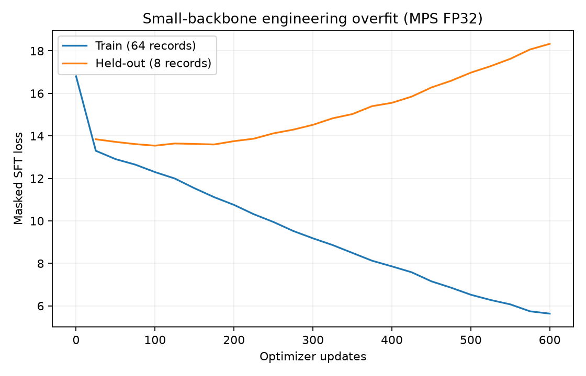

## 一、目标与完成范围

已完成官方小样本准备、固定划分、冻结特征缓存、损失与梯度检查、单设备训练、checkpoint/resume，以及 64 条样本的过拟合验收。没有训练 tokenizer，没有启动全尺寸正式 SFT、完整数据下载或 DDP。

本轮过拟合使用 150 万参数的小主干，随机初始化；SenseVoice/SigLIP2 使用本地预训练权重。该结果验证工程闭环，不代表 MiniMind 全尺寸模型已重新训练，也不证明多模态任务质量提升。

## 二、数据来源、许可与划分

### 1 官方小样本

来源：[jingyaogong/minimind-o_dataset](https://huggingface.co/datasets/jingyaogong/minimind-o_dataset/tree/d6588e12ac2ac8ced65eb58a7d7b3eef4aa220de)，固定 revision `d6588e12ac2ac8ced65eb58a7d7b3eef4aa220de`。用户明确授权只收集 64 条训练与少量独立验证；完整数据下载已放入待办。

原始 T2A/A2A mini 的单个 rowgroup 很大，直接迭代可能读取 GB 级列块。本轮只读取字典、前缀数据页及 footer，再由 PyArrow 解码候选；持久化的是重新编码的小表，不是假装完整的截断源文件。每次收集设 64 MiB 传输上限，严格检查 206/Content-Range/长度，服务端返回整文件时在读取 body 前停止。

首轮每任务前 32 行存在共享答案音频、同图多问，无法满足独立样本数量，保留为 `subset-assets.json`；第二轮在固定前缀候选内先去重再各保留 32 行，以 `subset-assets-v2.json` 为实际划分来源。两轮各传输 21,348,796 bytes，合计 42,697,592 bytes，均未下载完整源文件。压缩页可能包含未保留的额外编码行，不能将物理页传输描述成只读取了 72 行字节。

第二轮共保留 96 条独立候选，选出 64/8 条；剩余候选不参与训练或验证。清单记录官方大文件 LFS SHA、下载范围 SHA、本地小表 SHA、原始行号与 revision；没有宣称验证了未完整下载的大文件哈希。

官方卡声明 Apache-2.0、GPL-3.0，未逐文件区分。本地子集不提交或公开再分发。Parquet 格式定义取自 Apache 官方 2.11.0，保留其 LICENSE/NOTICE 和定义文件 SHA；`thriftpy2` 仅为可选数据工具。

### 2 固定 split 与缓存

| split | T2A | A2A | I2T | 合计 |
| --- | --- | --- | --- | --- |
| train | 22 | 21 | 21 | 64 |
| validation | 3 | 3 | 2 | 8 |

seed=42，记录与逐媒体跨任务去重，训练/验证互斥；保留原始源行号、子集行号和内容 ID。缓存只编码输入 question 音频与图像，answer 音频保持未来声学标签；不把未来音频特征注入输入。

| 缓存统计 | train | validation |
| --- | --- | --- |
| 有效文本标签 | 7,321 | 799 |
| 有效音频标签 | 64,056 | 10,064 |
| 含输入音频样本 | 21 | 3 |
| 含图像样本 | 21 | 2 |
| 最大 Token 长度 | 433 | 351 |

缓存使用确定性预处理，无变速、SpecAugment 或 scheduled sampling；训练和验证都不做随机增强，不存在变速后沿用旧码本标签的错位。标签只在 Dataset shift 一次。冻结特征缓存位于 `cache/p4/`，原始 split 位于 `.cache/p4/prepared/`，均忽略 Git。

## 三、损失、训练与恢复契约

文本 logits 为 `[B,T,V]`，音频 logits 为 `[B,C,T,A]`，标签分别为 `[B,T]`、`[B,C,T]`；`-100` 区域 CE 和梯度为零，全忽略时 CE 为可反传的零。MoE auxiliary loss 单独保留，不受标签 ignore mask 控制。

音频每路按有效 Token 数归一化，然后平均全部码本；stop 权重默认 10，保留原项目定义，不改成按权重和归一化：
$$L_{audio}=\frac{1}{C}\sum_{c=1}^{C}\frac{\sum_t m_{c,t}[1+(w-1)s_{c,t}]\operatorname{CE}_{c,t}}{\max(1,\sum_t m_{c,t})}$$
其中 $m$ 为有效监督 mask，$s$ 为 stop mask。本轮 $C=8$，$w=10$；完整目标为文本 CE、音频 CE 与辅助损失之和。

梯度累积先统计整组有效 Token 分母，再逐 micro-batch 反传，避免变长样本被等权 micro-batch 平均偏置。末组可不足预设长度。MoE auxiliary 按 micro-batch 平均；只有 CE 声称与完整 batch 的定义一致，本轮实际过拟合不启用 MoE。

冻结策略提供 all、audio、last_layer、audio_projector、vision_projector；不改权重键。AMP 与 GradScaler 接线覆盖 CPU BF16/FP16 测试，FP16 overflow 由 scaler 跳步/降 scale，成功更新与尝试数分开记录；真实 MPS 实验使用 FP32，未宣称 MPS AMP 或 DDP 已验收。

Checkpoint 在更新边界保存 model、optimizer、scaler、配置、冻结名单、Python/NumPy/Torch/设备 RNG、epoch/cursor 和缓存 SHA。恢复前校验配置与冻结策略，入口再校验数据与训练配置；独立 epoch shuffle Generator 不消耗 dropout RNG。每次新建 run，恢复不覆盖原 run，也不要求原初始化权重仍在。

## 四、真实运行与结果

### 1 三任务 smoke

实际执行 `scripts/check_p4.py --device mps`：T2A `[1,58]`、A2A `[1,149]`、I2T `[1,316]`。三个任务各成功反传与更新一次，损失和梯度有限；I2T 无声学监督，音频 CE 为零。数据来自官方缓存，模型为随机初始化小主干，不是随机媒体替代真实输入。

### 2 64 条工程过拟合

环境：macOS arm64，24 GiB 内存，Python 3.12.14、PyTorch 2.15.0、Transformers 4.57.6；MPS FP32，4 CPU 线程，seed=42。配置为 `configs/training/p4_overfit.yaml`：Thinker/Talker 宽度均 64、各 2 层，完整文本词表 6400、八码本音频词表 2112；可训练参数 1,507,202。

AdamW，学习率 0.003，weight decay=0，batch=2，梯度累积 2，grad clip=1；每 25 次更新评估/保存。训练集始终为相同 64 条。先运行 200 次更新，loss 未减半，再从 step-200 恢复到 600；原 run 保留。

| 指标 | 初始 | 200 次更新 | 600 次更新 |
| --- | --- | --- | --- |
| train 总 loss | 16.80580 | 10.75399 | 5.63626 |
| train 文本 CE | 8.76821 | 4.56329 | 0.79784 |
| train 音频 CE | 8.03759 | 6.19070 | 4.83843 |

最终训练 loss 为初始的 33.54%，下降 66.46%，达到预设减半标准。验证 loss 从首个 25 步测点约 13.84 上升到最终 18.33，表明发生刻意过拟合；本轮不据此宣称泛化、音质或任务准确率提升。



合并曲线只读取两个实际 run 的 CSV，相同步数以续跑记录为准，原 CSV 均保留；来源与 SHA 见 `overfit-loss-sources.json`。

### 3 恢复一致性

- CPU tiny fixture 含 dropout=0.1：2 步保存再恢复到 4，与连续 4 步的 model、optimizer、scaler、progress、RNG 和指标精确一致；不是 64 条真实训练证据。
- 真实 MPS 64 条分支：step-25 恢复到 step-50，与原连续 step-50 权重最大绝对差 `4.90621e-6`，在预先固定 `rtol=1e-4, atol=1e-4` 下通过；非逐元素完全相等。采样进度与 scaler 状态一致。

### 4 证据位置

| 证据 | 路径 |
| --- | --- |
| 官方固定来源与小表校验 | `experiments/p4/subset-assets-v2.json` |
| 64/8 源行号与划分 | `experiments/p4/data.json` |
| 冻结特征统计 | `experiments/p4/features.json` |
| 真实三任务反传 | `experiments/p4/smoke-20261104T125627176662Z.json` |
| 0→200 训练 | `experiments/p4/20261104T125629601507Z/` |
| 200→600 续跑 | `experiments/p4/20261104T125745458973Z/` |
| MPS 恢复对照 | `experiments/p4/resume-20261104T125743286505Z.json` |
| 最终 checkpoint（不提交） | `outputs/p4/20261104T125745458973Z/step-600.pt` |

### 5 最终工程检查

本地主机完整回归为 **144 passed，11.87 秒**，无跳过；包含真实主机的基础 MPS 运算。Ruff 静态检查通过，41 个 Python 文件格式通过；可编辑安装、`pip check`、离线 `uv lock --check` 与 wheel 构建通过。wheel 内容只包含 Python 包和分发元数据，不含权重、数据、音频或 Notebook。

普通测试使用临时 fixture，不自动下载或读取真实大模型；真实 P2/P3/P4 验收分别由显式脚本执行。Ubuntu CPU CI 已更新相同检查范围及 `media,plots` 测试依赖，本轮未推送，不能将本地通过当作远程 CI 已运行。

## 五、复现命令

已存在资产时直接激活环境；下载只由 collector 显式触发。新的来源、split、特征报告均需使用新路径，已有结果不会自动覆盖。

```bash
python -m pip install -e '.[dev,media,encoders,plots,data]'
# 仅在缺少官方子集时执行；路径需在 p4_data.yaml 同步
python scripts/collect_p4.py --output-dir cache/p4/sources-review --report experiments/p4/subset-review.json
# 一次生成 split；--cache-features 可在已有 split 上单独生成缓存
HF_HUB_OFFLINE=1 HF_DATASETS_OFFLINE=1 python scripts/prepare_p4.py
HF_HUB_OFFLINE=1 HF_DATASETS_OFFLINE=1 python scripts/prepare_p4.py --cache-features
HF_HUB_OFFLINE=1 HF_DATASETS_OFFLINE=1 python scripts/check_p4.py --device mps
# 显式启动同一批64条工程过拟合，600次更新
HF_HUB_OFFLINE=1 HF_DATASETS_OFFLINE=1 python scripts/train_sft.py --steps 600
# 恢复会实际继续训练，不是只读取checkpoint
python scripts/train_sft.py --resume outputs/p4/20261104T125629601507Z/step-200.pt --steps 600
```

## 六、相比原项目的补充与修改清单

| 原项目参考方式 | 本次补充或修改 | 审查入口 |
| --- | --- | --- |
| 训练数据直接本地读取 | 显式固定官方 revision、小样本 Range 收集与字节上限 | `scripts/collect_p4.py` |
| split/媒体身份不总是显式保留 | 全局内容/媒体去重、64/8 固定划分、源行号与 SHA | `omni/data/prepare.py` |
| 媒体与训练生命周期耦合 | 冻结特征缓存，增强关闭，未来答案保持标签 | `cache_split`、准备入口 |
| stop=2050、8 路平均写死在训练入口 | 损失独立，保留原数学定义，stop 权重与码本数可读可测 | `omni/training/losses.py` |
| 累积时按 micro-batch 平均 | 整组 Token 分母，变长 CE 对照通过 | `train_step`、单测 |
| overflow 可能被非有限梯度检查提前打断 | GradScaler 正常跳步/降 scale，计数明确 | `omni/training/sft.py` |
| 恢复只靠参数与优化器不足以保证相同后续批次 | 保存/校验配置、冻结、缓存 SHA、采样位置与 RNG | checkpoint helpers、训练入口 |
| 日志可能覆盖历史结果 | 新 run 保存每个 step checkpoint、CSV、曲线及源码 SHA | `scripts/train_sft.py` |
| 随机 fixture 与真实实验可能混淆 | 独立三任务真样本 smoke、CPU fixture恢复、MPS真实恢复及64条曲线 | `experiments/p4/` |

跨 P2–P4 的完整对照表见 [汇总报告第二章](../reports/P2-P4.md)。

## 七、局限与下一阶段入口

本轮完成 P4 工程与小样本验收，完整数据和全尺寸多阶段 SFT 尚未启动。DDP/多机、MPS AMP、speaker 提取器、全尺寸从 LLM 初始化的分阶段训练及正式质量评测仍需独立验收。

待办用 P4-D2/D3/D4 分别标记完整 T2A/A2A/I2T 下载，并说明 P5/P6/P7/P8/P9 的依赖。本轮验证集只有 8 条，不能作为正式 Benchmark。P5 不自动启动。
